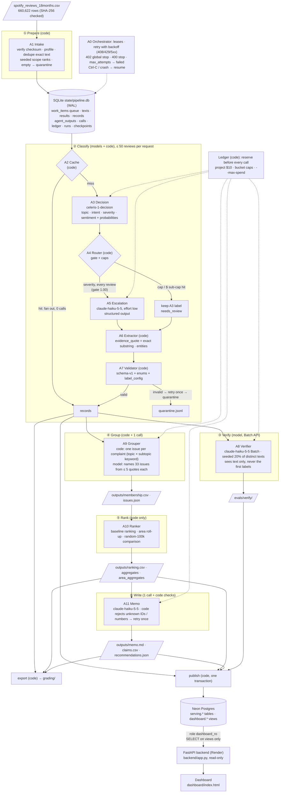

# Spotify review pipeline — where should the next quarter of product effort go?

A staged, multi-agent pipeline that turns the course's 660,622 Spotify Google Play reviews (May 2022 – Nov 2023) into a
product recommendation where every number traces back to saved calculations and source review IDs.

**Answer: usability** — the largest of the four effort areas by complaint count (20,720), severity sum (51,168) and share
of grouped complaints (20.4%), and still first on those three measures in the unbiased random 100k sample
([memo](outputs/memo.md), [claims](outputs/claims.csv)).

| | |
|---|---|
| **Live dashboard** | **https://spotify-review-pipeline.onrender.com** — public, no sign-in; API docs at [`/api/docs`](https://spotify-review-pipeline.onrender.com/api/docs). The free instance sleeps when idle: the first request can take ~1 minute. |
| **Decision memo** | [`outputs/memo.md`](outputs/memo.md) (+ [`claims.csv`](outputs/claims.csv), [`recommendations.json`](outputs/recommendations.json)) |
| **Grading export** | [`grading/`](grading/) — `records.jsonl.gz` (660,622 records), `calls.jsonl.gz` (4,552 calls), `run.json`, `ingestion.json`, `membership.csv`, `ranking.csv`, `claims.csv`, `checkpoint_before/after.json` |
| **Cost calculator** | [`cost/`](cost/README.md) — 100-review cold/warm pilot [`report_pilot.md`](cost/report_pilot.md), offline replay `python cost/calculator.py`, dated [`rates.csv`](cost/rates.csv) |
| **Final run** | label_config `celeris-1-decision+shapeA+gate1.00+esc-claude-haiku-5-5-1.00+escfields-severity+extract-code-v1+prompt-v1+schema-v1+sentiment-mode-v1` on `state/pipeline.db`, runs `run-20261015-094806-7e9c37` (initial, deliberately interrupted) → `run-20261015-094822-868f46` (resume, random 100k) → `run-20261015-102812-b0aa2c` (frequency add-on) — [`evals/m8/notes.md`](evals/m8/notes.md) |
| **Total spend** | **$4.33 list price** of the $10 budget — see [Cost](#cost) |

> **Scope, up front.** All 660,622 rows are ingested, profiled and given exactly one record. Models classified a seeded
> random **100,000** nonempty reviews plus the **25,000 most duplicated** remaining texts; exact-text reuse filled in every
> other row with an identical text. That completes **279,519** records. The other **381,090** nonempty rows are
> quarantined as `out_of_scope_budget_100k` — *accounted for, not classified* — because classifying all of them did not fit
> the budget ([decision](cost/full_corpus_decision.md)). 13 empty texts are quarantined as `empty_review_text`.
> This is not a full-corpus classification run, and the checker reports it as `unfinished_classification` (see
> [Grading export](#grading-export-and-checker)).

---

## Contents
1. [Rubric → evidence map](#rubric--evidence-map)
2. [Results summary](#results-summary)
3. [Architecture](#architecture)
4. [Labels, models and settings](#labels-models-and-settings)
5. [Ranking: baseline, aggregation, tie-break, scope](#ranking-baseline-aggregation-tie-break-scope)
6. [Decision memo](#decision-memo)
7. [One review traced end to end (+ an ambiguous and a failed case)](#one-review-traced-end-to-end)
8. [Golden-set evaluation](#golden-set-evaluation)
9. [Independent verification, planted errors, prompt injection](#independent-verification-planted-errors-prompt-injection)
10. [Interruption and resume](#interruption-and-resume)
11. [Cost](#cost)
12. [Dashboard, backend and database](#dashboard-backend-and-database)
13. [Grading export and checker](#grading-export-and-checker)
14. [Setup and commands](#setup-and-commands)
15. [Limitations and disclosures](#limitations-and-disclosures)
16. [Dataset](#dataset)
17. [Repository layout](#repository-layout)

---

## Rubric → evidence map

| Rubric item | Evidence |
|---|---|
| **DQ1** Accessible code, setup, artifacts | [Setup and commands](#setup-and-commands); pinned [`requirements.txt`](requirements.txt); blank [`.env.example`](.env.example); [`.gitignore`](.gitignore) (excludes `.env`, raw data, local state); clean-clone test in [`evals/m12/clean_env.md`](evals/m12/clean_env.md) |
| **DQ2** Architecture, shared schema, provenance | [Architecture](#architecture); schema [`pipeline/schema.py`](pipeline/schema.py) + [`pipeline/db/schema.sql`](pipeline/db/schema.sql); labels [`labels/taxonomy.md`](labels/taxonomy.md); run manifest [`grading/run.json`](grading/run.json), [`outputs/data_manifest.json`](outputs/data_manifest.json), [`outputs/run_log.jsonl`](outputs/run_log.jsonl); `label_config` on every record and call; `cache_source_id` on every reused record |
| **DQ3** Memo numbers ↔ calculations ↔ evidence | [`outputs/claims.csv`](outputs/claims.csv) (11 claims, values from `ranking.csv`); the memo's code-generated **number trace** table maps every number to a claim ID or a field of [`outputs/memo_input.json`](outputs/memo_input.json); [`evals/m9/rank_check.json`](evals/m9/rank_check.json) (checker algorithm: 10/10 claims match); dashboard re-checks every claim (`v_claims.matches`) |
| **DQ4** Coherent recommendation, alternatives, limitations | [`outputs/memo.md`](outputs/memo.md) (priority, 3 recommendations, alternatives, robustness, limitations); dashboard recommendations panel; live smoke [`evals/m11/smoke_live.json`](evals/m11/smoke_live.json); memo slips disclosed [below](#limitations-and-disclosures) |
| **TE1** 50 human labels, per-field comparison, error analysis | [`evals/golden/golden_eval.md`](evals/golden/golden_eval.md), every disagreement in [`golden_disagreements.csv`](evals/golden/golden_disagreements.csv), labels [`golden_50_labeled.csv`](evals/golden/golden_50_labeled.csv); M6 → M6b comparison [`golden_m6_vs_m6b.md`](evals/golden/golden_m6_vs_m6b.md); tuning set kept apart in [`evals/dev_100/`](evals/dev_100/) and [`evals/heldout_30/`](evals/heldout_30/) |
| **TE2** Independent verification + planted-error + injection tests | [`evals/verify/verify_report.json`](evals/verify/verify_report.json), [`disagreements.csv`](evals/verify/disagreements.csv), [`planted_errors.json`](evals/verify/planted_errors.json); [`evals/m9/notes.md`](evals/m9/notes.md) (investigation); [`evals/system_tests/results.md`](evals/system_tests/results.md) (12 scenarios PASS + real-model injection) |
| **TE3** (a) real cold/warm pilot (b) offline calculator (c) retry/spend/recovery controls | (a) [`cost/report_pilot.md`](cost/report_pilot.md) + [`cost/pilot_measured.json`](cost/pilot_measured.json), [`usage.csv`](cost/usage.csv), [`pilot_calls.jsonl`](cost/pilot_calls.jsonl); (b) [`cost/calculator.py`](cost/calculator.py) (stdlib only, rate-doubling test in [`tests/test_m5_cost.py`](tests/test_m5_cost.py)); (c) [`pipeline/db/ledger.py`](pipeline/db/ledger.py), [`pipeline/db/queue.py`](pipeline/db/queue.py), system tests `transient_failures`, `spend_controls`, `hard_kill_recovery` |
| **WR1** Full ingestion, coverage, classification | [`grading/ingestion.json`](grading/ingestion.json) (the provided `profile`), [`grading/records.jsonl.gz`](grading/records.jsonl.gz): 660,622 records = 279,519 completed + 381,103 quarantined (0 missing); [`evals/m8/finalize.json`](evals/m8/finalize.json); coverage point candidate **0.6539** |
| **WR2** Runnable staged program, bounded calls, saved handoffs, resume | [`pipeline/cli.py`](pipeline/cli.py) (`run --input <csv>`, `enrich`, `resume`, `verify`, `group`, `rank`, `memo`, `export`, `publish`); ≤ 50 reviews per request; [`grading/calls.jsonl.gz`](grading/calls.jsonl.gz); resume evidence [`evals/recovery/`](evals/recovery/README.md) (checker resume rules PASS; screen recording kept by the author, available on request) |
| **WR3** Reproducible ranking + deployed dashboard/backend/DB with grounded AI recommendations | `python -m pipeline.cli rank` (zero calls, byte-identical); live URL above; [`docs/DASHBOARD.md`](docs/DASHBOARD.md); [`evals/m11/smoke_live.json`](evals/m11/smoke_live.json) (12/12 API numbers equal the saved files) |

---

## Results summary

Everything in this table is **measured** from saved files unless marked *estimate*.

### Records (accounted for vs classified)

| | Rows | Source |
|---|---:|---|
| Source rows ingested | **660,622** | [`grading/ingestion.json`](grading/ingestion.json) |
| Records exported (one per row, 0 missing, 0 orphans) | 660,622 | [`evals/m8/finalize.json`](evals/m8/finalize.json) |
| **Completed (classified)** | **279,519** | |
| ↳ seeded random 100k (scope ranks 1–100,000) | 100,000 | |
| ↳ frequency add-on (top 25,000 out-of-scope distinct texts) | 41,577 | |
| ↳ out-of-scope rows whose exact text was already classified | 137,942 | |
| ↳ of all completed, **by exact-text cache reuse** (`cache_source_id`) | 176,420 | |
| **Quarantined** | **381,103** | |
| ↳ `out_of_scope_budget_100k` (nonempty, never sent to a model) | 381,090 | |
| ↳ `empty_review_text` | 13 | |
| Completed with `needs_review = true` | 17,708 | [`outputs/overall_metrics.json`](outputs/overall_metrics.json) |
| Distinct texts sent to the enrichment chain | 78,099 (100k) + 25,000 (add-on) | |

### Quality

| Check | Result | Source |
|---|---|---|
| Golden 50 (hand labels), accepted alternatives counted | topic **88%**, intent **90%**, severity **80%** (MAE 0.30), sentiment MAE 0.305 / 62% within ±0.25; quotes 100% exact substrings | [`golden_eval.md`](evals/golden/golden_eval.md) |
| Independent verifier (Haiku 5.5, Batch, declared 20% seeded sample) | 20,483 texts verified, **200 unverified**; agreement topic **79.7%**, intent **84.6%**, severity **82.3%** (±1: 99.4%); 8,564 reviews with ≥ 1 disagreement | [`verify_report.json`](evals/verify/verify_report.json) |
| Does the conclusion move under verifier labels? | Usability stays first; playback and billing/support swap 2nd/3rd | [`evals/m9/notes.md`](evals/m9/notes.md) |
| Planted errors | verifier 3/3 + 5/5 flagged; 12/12 contract violations rejected by `validate_record` | [`planted_errors.json`](evals/verify/planted_errors.json), [`system_tests`](evals/system_tests/results.md) |
| Real-model prompt injection (6 injections + 4 controls) | **no label followed an injected instruction**; no output for unsent reviews | [`injection_real_notes.md`](evals/system_tests/injection_real_notes.md) |
| Interruption → resume | checker resume rules **PASS** (130,221 → 130,382 IDs; 0 re-sent) | [`evals/recovery/resume_check.json`](evals/recovery/resume_check.json) |
| Ranking reproducibility | `rank` byte-identical on rerun, zero model calls; checker algorithm 33/33 rows, 10/10 claims | [`rank_check.json`](evals/m9/rank_check.json) |

### Cost and time of the final run

| | Measured | Estimate made beforehand |
|---|---|---|
| Enrichment, random 100k (A3 + A5) | **$2.3989** list, 2,788 calls (2 failed: in flight at the deliberate interrupt), 38.9 min wall-clock at 4 workers | $2.42 base ([`cost/report.md`](cost/report.md)) |
| Enrichment, frequency add-on | **$0.8128**, 1,000 calls, 0 failed, 13.2 min | $0.87 base |
| Verification, grouping naming, memo (A8/A9/A11) | **$0.4330**, 419 + 1 + 4 calls | $0.57 base |
| **Final run total** | **$3.6447 list** | $3.86 base |
| Tokens in the export (4,552 calls) | 39,123,254 input / 4,861,837 output | |
| Warm rerun of a completed stage | 0 calls (cache), 0.03 s on the 10k | |

Local compute (SQLite, ranking, export) is not metered and is reported as unknown, not zero.

---

## Architecture



### What each role does, and why a model is (or is not) used

| Role | Code or model | Input → output | Why |
|---|---|---|---|
| **A0 Orchestrator** ([`orchestrator.py`](pipeline/orchestrator.py)) | code | queue leases → calls, one transaction per call outcome | Control must be deterministic: N async workers, fenced leases, shared rate limits and spend reservations, heartbeats, stop reasons, resume. |
| **A1 Intake** ([`agents/intake.py`](pipeline/agents/intake.py)) | code | CSV → `source_reviews`, `texts`, queue, `ingestion.json` | Checksums, profiling, dedupe and seeded scope ranks are exact computations. |
| **A2 Cache** ([`agents/cache.py`](pipeline/agents/cache.py)) | code | text hash → stored result, fan-out to every row with that text | 21,901 duplicate rows in the 100k and 137,942 out-of-scope rows were completed for $0. |
| **A3 Decision** ([`agents/decision.py`](pipeline/agents/decision.py), [`prompts/decision_state_v1.md`](prompts/decision_state_v1.md)) | `celeris-1-decision` (Jev/System One) | ≤ 50 `[R<n>]` reviews → a probability for every allowed label | Fixed-label classification of free text needs a model; this one is the cheapest per review ($0.04/M input, output free) and returns probabilities the router can gate on. |
| **A4 Router** ([`agents/router.py`](pipeline/agents/router.py)) | code | A3 probabilities → accept / escalate / capped | A threshold and a cap are arithmetic. |
| **A5 Escalation** ([`agents/escalation.py`](pipeline/agents/escalation.py), [`prompts/escalation_system_v1.md`](prompts/escalation_system_v1.md)) | `claude-haiku-5-5`, effort low | severity question with A3's top-2 → severity + needs_review | Severity was A3's weakest field on dev/held-out data; Haiku is cheap and was more accurate there ([`evals/m6_notes.md`](evals/m6_notes.md)). |
| **A6 Extractor** ([`agents/extractor.py`](pipeline/agents/extractor.py)) | code | text → `evidence_quote`, `entities` | A quote must be an exact substring; cutting it in code makes that guaranteed and injection-proof. |
| **A7 Validator** ([`agents/validator.py`](pipeline/agents/validator.py)) | code | labels → valid record or retry/quarantine | Enums and the contract schema are exact. |
| **A8 Verifier** ([`agents/verifier.py`](pipeline/agents/verifier.py), [`prompts/verifier_system_v1.md`](prompts/verifier_system_v1.md)) | `claude-haiku-5-5` via Batch API (50% off) | text only → independent topic/intent/severity | Independent second opinion on a declared sample; never writes to records. |
| **A9 Grouper** ([`agents/grouper.py`](pipeline/agents/grouper.py), [`labels/subtopics.yaml`](labels/subtopics.yaml)) | code + 1 call | complaints → one issue each (code); issue names (model) | Membership must be deterministic and complete; only naming needs language. |
| **A10 Ranker** ([`agents/ranker.py`](pipeline/agents/ranker.py)) | code | saved files → ranking, aggregates | Must be reproducible with zero calls. |
| **A11 Memo** ([`agents/memo.py`](pipeline/agents/memo.py), [`prompts/memo_system_v3.md`](prompts/memo_system_v3.md)) | `claude-haiku-5-5` + code checks | aggregates + top issues + quotes → memo, claims, recommendations | Writing needs a model; code rejects any number, issue ID, review ID or claim ID that is not in the input. |

Stored artifacts and handoffs: every stage reads and writes saved state (SQLite tables or files in `outputs/`), never chat
output. `agent_outputs` saves A3/A4/A5 per text with the call, so an A5 failure, a lost lease or a resume never re-pays A3.
Shared record schema: `pipeline/schema.py` (schema-v1) mirrors the checker's per-record rules.

---

## Labels, models and settings

- **Labels:** the contract's common labels, verbatim, plus our conventions (sentiment scale, entities, evidence quote,
  `needs_review`, accepted alternatives, boycott slogans → `unclear`): [`labels/taxonomy.md`](labels/taxonomy.md),
  worked examples [`labels/examples.yaml`](labels/examples.yaml), area roll-up [`labels/areas.yaml`](labels/areas.yaml),
  keyword lists [`labels/keywords.yaml`](labels/keywords.yaml), subtopics [`labels/subtopics.yaml`](labels/subtopics.yaml).
- **Classification input:** `review_text` only. Stars, likes, version and date are never sent to a model.
- **Frozen `label_config`** (M6b), recorded on every record and call:
  `celeris-1-decision+shapeA+gate1.00+esc-claude-haiku-5-5-1.00+escfields-severity+extract-code-v1+prompt-v1+schema-v1+sentiment-mode-v1`
  - `celeris-1-decision`, request shape A (definitions + ≤ 50 reviews per request; 4 questions per review)
  - topic and intent = A3's most probable label; **severity = Haiku for every review** (gate 1.00, cap 1.00);
    sentiment = A3's most probable level (ties → nearer 0), mapped to −1..1
  - `claude-haiku-5-5` (Claude Haiku 5.5), effort `low`, structured JSON output, SDK `anthropic==1.13.0`
- **Verifier:** `claude-haiku-5-5+verifier-prompt-v1+effort-low`, Message Batches API, seed `verify-v1`, rate 0.20.
- **Memo:** `claude-haiku-5-5`, `memo-prompt-v3`, request `d242c731f47f42b2adfc27cced81aa51`.
- How the config was chosen (pilot → 500 → 10k, gate sweep, held-out 30, Sonnet test): [`evals/m6_notes.md`](evals/m6_notes.md),
  [`evals/threshold_sweep/sweep.md`](evals/threshold_sweep/sweep.md), [`cost/comparisons.md`](cost/comparisons.md).

---

## Ranking: baseline, aggregation, tie-break, scope

- **Baseline (contract):** one issue per complaint/cancellation record (`allow_multi_issue: false`).
  `complaint_count` = members, `severity_sum` = Σ severity, `mean_severity` = sum/count (6 decimals, half-up, the
  checker's `mean_string`), **`priority_score` = `severity_sum`**. Sort by `priority_score` desc, then `issue_id` asc;
  ranks from 1. → [`outputs/ranking.csv`](outputs/ranking.csv) (33 issues).
- **Scope of the ranking:** every completed complaint/cancellation record — **101,649 members** (random 100k 47,920 ·
  exact-text fills 36,336 · add-on 17,393). The checker requires all of them in `membership.csv`.
- **Area roll-up (declared extra aggregate):** access ← access · usability ← usability · playback ← playback + downloads ·
  billing/support ← billing + support · outside ← catalog + other ([`area_aggregates.csv`](outputs/area_aggregates.csv)).
- **Unbiased comparison:** the same computation on the 47,920 members from the seeded random 100k only
  ([`comparison_random_100k_areas.csv`](outputs/comparison_random_100k_areas.csv)). The main ranking over-weights short,
  heavily duplicated texts (mostly `other-general`, 57,823 members), so this is the check the memo leans on.

| Area | Complaints (all) | Severity sum | Mean severity | Share of members | Complaints (random 100k) | Severity sum (random 100k) |
|---|---:|---:|---:|---:|---:|---:|
| **usability** | **20,720** | **51,168** | 2.469498 | **20.4%** | **13,525** | **34,936** |
| playback | 9,055 | 30,205 | 3.335726 | 8.9% | 6,976 | 23,350 |
| billing/support | 8,176 | 21,907 | 2.679428 | 8.0% | 6,311 | 17,130 |
| access | 2,339 | 8,508 | **3.637452** | 2.3% | 1,493 | 5,912 |
| outside (catalog + other) | 61,359 | 119,041 | 1.940074 | 60.4% | 19,615 | 38,892 |

Top issues inside the four areas: `usability-ads` (rank 2; 8,131 complaints), `usability-general` (3; 6,087),
`playback-general` (4; 4,288), `billing-subscription` (5; 3,636). Rank 1 is `other-general` (outside the four areas).

**Trend analysis:** not done beyond the two samples above. The first (2022-05) and last (2023-11) calendar months are
partial, so any month-over-month comparison would need matching periods and denominators.

Rerun it: `python -m pipeline.cli rank` (zero model calls; byte-identical outputs).

---

## Decision memo

[`outputs/memo.md`](outputs/memo.md) — generated once by A11 from [`outputs/memo_input.json`](outputs/memo_input.json);
every number was checked by code and is mapped in its **Number trace** table.

- **Priority:** usability (complaint count, severity sum and share of members; holds in the random 100k).
- **Recommendations:** (1) fix playback controls / interface regressions after updates; (2) review the ad experience incl.
  timer behaviour; (3) investigate freezing and failure to open — each with issue IDs, claim IDs and review IDs.
- **Alternatives:** playback (higher mean severity, smaller volume), billing/support (350 cancellation intents), access
  (highest mean severity, smallest volume).
- **Limitations** stated in the memo: scope and quarantines, duplication bias, model labels, severity ≠ impact,
  cancellation intent ≠ churn.

Two wording slips in the memo are **disclosed, not fixed** (decision recorded in [`evals/m9/notes.md`](evals/m9/notes.md)):
1. *"Playback leads on mean_severity"* — among the four areas **access** leads (3.637452); playback (3.335726) is second.
   The same paragraph then says access is highest, so the sentence contradicts itself.
2. *"…so the mean_severity order differs from the main ranking"* — it does not: access > playback > billing/support >
   usability in both the main ranking and the random 100k.
Neither changes the recommendation, which rests on complaint count, severity sum and share. Code checks verify numbers
and IDs, not comparisons, so they did not catch these.

---

## One review traced end to end

Full traces (generated read-only by [`scripts/trace_review.py`](scripts/trace_review.py)):
[`evals/m12/trace_ok.md`](evals/m12/trace_ok.md) and [`evals/m12/trace_ambiguous.md`](evals/m12/trace_ambiguous.md).

**Review `8c256cff-407f-4f2c-ad6e-dabdeef1bf0d`** (CSV row 33,484; random 100k, scope rank 10,249; 1 star):
*"…it would play a 30 second ad … But even though the ad was over, the timer was still counting up. I couldn't do anything
on the app and all of my playlists had been removed…"*

| Step | What happened | Evidence |
|---|---|---|
| Enrichment A3 | `celeris-1-decision` request `8f500360…` (50 reviews): usability 0.92, complaint 0.98, severity 5 (0.68) / 4 (0.29) | `agent_outputs`, `grading/calls.jsonl.gz` |
| A4 → A5 | routed for severity (gate 1.00); Haiku request `92ef9e75…` → severity **5**, needs_review false | same |
| A6/A7 | evidence_quote *"But even though the ad was over, the timer was still counting up."* (exact substring), entities playlists, search → valid record | `grading/records.jsonl.gz` |
| Verification A8 | Batch request `cd3a820f…`: intent and severity agree; **topic disagrees (verifier: access)** — the review also reports an account problem | `evals/verify/verifier_predictions.jsonl` |
| Membership | issue `usability-ads` | `outputs/membership.csv` |
| Ranking | rank 2: 8,131 complaints, severity_sum 18,508, mean 2.276227 | `outputs/ranking.csv` |
| Memo claim | **C02a** (complaint_count 8131), **C02b** (severity_sum 18508); quoted in *Supporting evidence*; cited by recommendation 2 | `outputs/claims.csv`, `outputs/memo.md` |

**Ambiguous case — `7ad378f0-d06c-43f1-90d0-add62230bf2c`:** *"A buzzing noise in background … other then that its a good
app"*. A3's intent is split (praise 0.60 / complaint 0.22 / cancellation 0.13); Haiku set `needs_review: true`; the
verifier says complaint. **Handling:** one valid best-guess label (playback / praise / 2) with the flag, not a quarantine;
as praise it is not grouped, so it does not move the ranking.

**Failed case — A8 request `814c11ff4b554cbe9b18f1243b64493e`:** a 50-review verifier batch hit `max_tokens` → unparseable →
`failed` (recorded in `calls.jsonl.gz`); requeued once, then left unverified (200 texts, 1.0% of the sample). Records are
never changed by verification.

---

## Golden-set evaluation

- **Expected labels:** [`evals/golden/golden_50_labeled.csv`](evals/golden/golden_50_labeled.csv) — 50 reviews (seed ranks 1–50),
  hand-labeled by the author before any model saw them, with accepted alternatives for genuinely ambiguous rows (22 cases).
  Golden labels were never used for tuning (a code firewall test keeps golden text out of prompts and label files).
- **Predictions vs expected, per field:** [`golden_eval.md`](evals/golden/golden_eval.md); every disagreement with both answers:
  [`golden_disagreements.csv`](evals/golden/golden_disagreements.csv) (40 rows incl. sentiment beyond ±0.25).

| Field | Exact | Accepted |
|---|---:|---:|
| topic | 78% | **88%** |
| intent | 86% | **90%** |
| severity | 70% | **80%** (MAE 0.30) |
| sentiment | MAE 0.305 | 62% within ±0.25 |
| evidence quote | 100% exact substrings | 98% overlap the gold quote |
| needs_review as error flag | precision 67% | recall 11% |

**Error analysis.** Topic errors are boundary cases (usability ↔ billing for premium/ads complaints, `other` texts pulled into
a product topic). Severity: the M6 config scored 90% and the frozen M6b config 80% on the same 50; we traced that to Haiku
**run-to-run noise** (27% of its severity answers changed between two runs on identical texts) rather than a worse config
([`golden_m6_vs_m6b.md`](evals/golden/golden_m6_vs_m6b.md)); the M6b change was chosen on separate held-out data
([`evals/heldout_30/`](evals/heldout_30/)). Sentiment is pulled toward 0. `needs_review` rarely fires because only A5 sets
it and A5 only answers severity.

---

## Independent verification, planted errors, prompt injection

- **Procedure:** a declared, seeded random sample — distinct texts where sha256(`verify-v1:text_sha256`)/2^256 < 0.20
  (20,683 texts: 15,658 random 100k + 5,025 add-on). A8 sees the review text only (a test proves the stored labels cannot
  change its request), runs on the Batch API, and writes to its own table. Results:
  [`verify_report.json`](evals/verify/verify_report.json), [`disagreements.csv`](evals/verify/disagreements.csv),
  predictions [`verifier_predictions.jsonl`](evals/verify/verifier_predictions.jsonl).
- **What disagrees** ([`evals/m9/notes.md`](evals/m9/notes.md), [`verify_investigation.json`](evals/m9/verify_investigation.json)):
  topic catalog/usability/playback → other; usability → billing (ads/upsell); intent complaint → unclear/cancellation;
  the verifier is milder on severity; agreement drops with text length. Under verifier labels usability is still first
  but billing/support overtakes playback for second.
- **Planted errors:** 3 flipped topics in a synthetic copy → all flagged ([`planted_errors.json`](evals/verify/planted_errors.json));
  5/5 more in M7, plus 12/12 planted contract violations rejected by the validator and a planted resume re-send flagged.
- **System tests** ([`results.md`](evals/system_tests/results.md), all PASS, synthetic DBs only): an "obedient" fake model
  injecting labels, foreign review slots and extra reviews; malformed output (bisect + retry → quarantine); empty text;
  ambiguous labels; 429/408/402/400/max_attempts; spend caps; hard kill → resume; A9/A11 invented IDs/numbers rejected.
- **Real-model injection** (Celeris + Haiku + Haiku verifier; 6 injections + 4 controls,
  [`injection_real_notes.md`](evals/system_tests/injection_real_notes.md)): no label followed an injected instruction, no
  output for unsent reviews, format intact. Weakness: for 2 reviews the code-cut quote is the injection sentence itself.

---

## Interruption and resume

[`evals/recovery/`](evals/recovery/README.md): the main run was started by [`scripts/resume_demo.py`](scripts/resume_demo.py),
**interrupted on purpose** after 4 A3 batches (exit 130, `stop_reason=interrupted`, 2 in-flight calls closed as failed and
settled at their estimate) → [`checkpoint_before.json`](evals/recovery/checkpoint_before.json) **130,221** IDs →
`pipeline.cli resume` → [`checkpoint_after.json`](evals/recovery/checkpoint_after.json) **130,382** → the checker's resume
rules (local copy, [`pipeline/recovery.py`](pipeline/recovery.py)) **PASS**, and PASS again when the resume run drained
(0 resume calls re-sent a before ID) — [`resume_check.json`](evals/recovery/resume_check.json), logs `enrich_initial.log`,
`resume.log`. The author screen-recorded the demo. The checkpoints are also in `grading/`.

---

## Cost

### 100-review pilot (measured, cold then warm) — [`cost/report_pilot.md`](cost/report_pilot.md)
`cost_100.csv` (checksum checked), 1 worker, every stage: **cold 42 s, 6 calls, $0.006352**; **warm 0.3 s, 0 calls**.
Raw evidence: [`pilot_measured.json`](cost/pilot_measured.json), [`usage.csv`](cost/usage.csv),
[`pilot_calls.jsonl`](cost/pilot_calls.jsonl), [`pilot_records.jsonl`](cost/pilot_records.jsonl). (Pilot config was the
M5 one; the 10k scale runs re-measured the frozen config: [`cost/m6/scale_runs.md`](cost/m6/scale_runs.md),
[`cost/m6b/`](cost/m6b/).)

### Calculator (offline, no API key) — [`cost/README.md`](cost/README.md)
`usage.csv × rates.csv` → report with measured tables, projections (full corpus with/without reuse, our scope; base +
conservative), controls (budget, output-token cap, concurrency, fallback fraction, verify rate/tier, volumes) and budget
warnings. Rates are dated with source links in [`cost/rates.csv`](cost/rates.csv) (checked 2026-10-12). Importing or
running it never calls an API.

| Report | Replay command (writes to `--out`) |
|---|---|
| pilot ([`report_pilot.md`](cost/report_pilot.md)) | `python cost/calculator.py --out /tmp/replay` |
| 100k under the frozen config ([`report.md`](cost/report.md)) | `python cost/calculator.py --usage cost/m6b/usage.csv --measured cost/m6b/measured.json --calls cost/m6b/calls.jsonl --max-fallback-fraction 1.0 --verify-rate 0.2 --out /tmp/replay` |

Both reproduce the committed `.md` byte for byte. Projections are estimates: 100k $3.11 base / $4.73 conservative;
100k + add-on $4.10 / $6.24 ([`cost/m6b/report_100k_plus_addon.md`](cost/m6b/report_100k_plus_addon.md)); full corpus
$19.26 / $29.28 → **no-go** ([`full_corpus_decision.md`](cost/full_corpus_decision.md)).

### Spend to date (list price; credits are not treated as free)

| Module | List price | Notes |
|---|---:|---|
| M0 smoke, M5 pilot | $0.0169 | incl. 2 failed pilot attempts |
| M6 scale + golden | $0.2090 | |
| M6b fidelity upgrade | $0.4572 | incl. Sonnet topic test (not adopted) |
| M7 real-model injection | $0.0020 | |
| M8 main run + add-on | $3.2117 | Celeris $1.0442 + Haiku $2.1675 |
| M9 verify, group, memo | $0.4330 | |
| M10–M12 | $0 | no API calls |
| **Project total** | **≈ $4.3298** | **Celeris ≈ $1.2492 paid from prepaid credit · Anthropic ≈ $3.0807 cash** |

Attempts whose billing is unknown are counted at their ledger estimate, never as $0: two Haiku client connection errors
(M6 $0.0132, M6b $0.1135), one M9 memo connection error, and the 2 calls in flight at the deliberate interrupt. The
provider Consoles may show less. Ledger: [`pipeline/db/ledger.py`](pipeline/db/ledger.py)
(reserve before every call; project $10, per-bucket caps, per-run `--max-spend`).

---

## Dashboard, backend and database

**https://spotify-review-pipeline.onrender.com** — public, no sign-in, read-only. Details: [`docs/DASHBOARD.md`](docs/DASHBOARD.md).

- Shows: scope disclaimer; overall metrics (rows, completed/quarantined by reason, cache reuse, needs_review, coverage
  point, label distributions); the area roll-up; the 33-issue ranking (click an issue for its reviews); the three AI
  recommendations with their claims re-checked against the published aggregates (✓/✗) and evidence quotes that open the
  full review; verifier and golden accuracy; model calls and cost.
- Data path: `python -m pipeline.cli publish` loads 660,622 records, issues, membership, ranking, aggregates, claims,
  recommendations, run and cost summaries into **Neon Postgres** (`serving.*` tables, `dashboard.*` views) in one
  transaction → **FastAPI** ([`backend/app.py`](backend/app.py), Render, [`render.yaml`](render.yaml)) connects as the
  read-only role `dashboard_ro` → **static dashboard** ([`dashboard/index.html`](dashboard/index.html)). Neither the
  backend nor the dashboard calls a model.
- Check it yourself, no keys needed: `python scripts/smoke_dashboard.py --base-url https://spotify-review-pipeline.onrender.com`
  compares 12 API numbers with the saved files in `outputs/` → last run: **12/12 equal**
  ([`evals/m11/smoke_live.json`](evals/m11/smoke_live.json)).
- Database setup (to deploy your own): create a Neon project, put the owner URL in `DATABASE_URL` and a password in
  `DASHBOARD_RO_PASSWORD`, run `publish`, then set `DASHBOARD_DATABASE_URL` (role `dashboard_ro`) on the host.

---

## Grading export and checker

`python -m pipeline.cli export` builds [`grading/`](grading/) deterministically (gzip mtime 0); details in
[`evals/m10/notes.md`](evals/m10/notes.md). Checker = the instructor's [`pipeline/check_submission.py`](pipeline/check_submission.py),
**unchanged**. Result of `check` (report kept outside `grading/`):

- status **`review_required`** with a single issue: **`unfinished_classification` = 381,090** — exactly the out-of-scope
  nonempty rows quarantined as `out_of_scope_budget_100k`. This is the scope decision above, not a pipeline failure.
- valid completed 279,519 (176,420 valid cache reuses) · quarantined 381,103 · missing 0 · invalid 0 · accounted 1.0 ·
  **coverage point candidate 0.6539** · 4,552 calls, 39,123,254 input / 4,861,837 output tokens.
- **344 succeeded enrich calls left out of `calls.jsonl.gz`:** 172 A3 + 172 A5 calls from the superseded M6 config
  (`…gate0.70+esc-claude-haiku-5-5-0.40…`) on the first 10k, whose reviews were re-done under the frozen config (those calls
  are exported). Including them would trigger `call_config_mismatch`. The full list is in
  [`evals/m10/export.json`](evals/m10/export.json) → `excluded_calls`; their cost is in the spend table.
- Failed calls are included as real outcomes (2 interrupted enrich, 9 verify, 2 memo).
- `grading/records.jsonl.gz` is 50.8 MB — above GitHub's 50 MB recommendation, below the 100 MB limit; it downloads normally.

---

## Setup and commands

Requirements: Python 3.12. Tested on Windows 11 (paths below use POSIX style; on Windows use
`.venv\Scripts\python`).

```bash
git clone https://github.com/rplewman/spotify-review-pipeline.git
cd spotify-review-pipeline
python -m venv .venv
.venv/bin/python -m pip install -r requirements.txt
```

### Without any API key (inspect and recalculate)

```bash
# offline cost calculator replay (stdlib only)
.venv/bin/python cost/calculator.py --out /tmp/replay
# deterministic ranking from saved outputs: zero model calls, byte-identical to the committed files
.venv/bin/python -m pipeline.cli rank
git status --short outputs/
# fast test suite (offline; Neon tests skip without TEST_DATABASE_URL)
.venv/bin/python -m pytest -q -m "not data"
# compare the live dashboard with the saved files
.venv/bin/python scripts/smoke_dashboard.py --base-url https://spotify-review-pipeline.onrender.com
```

The checker additionally needs the dataset (see [Dataset](#dataset)); unzip it to `data/raw/`:

```bash
.venv/bin/python pipeline/check_submission.py reference --full data/raw/spotify_reviews_18months.csv --analysis data/raw/spotify_reviews_18months.csv --out local-reference.json
.venv/bin/python pipeline/check_submission.py check --reference local-reference.json --submission grading --out self-check.json
```

### Running the pipeline (paid steps are explicit)

Copy `.env.example` to `.env` and fill in `CELERIS_API_KEY`, `ANTHROPIC_API_KEY` (and `DATABASE_URL` for `publish`).
Every paid command refuses to run without `--paid` **and** `--max-spend` (USD, list price); without them the same commands
run offline on a fake provider (on a separate `--db`).

```bash
.venv/bin/python -m pipeline.cli ingest                                  # A1, no API calls, ~1.5 min
.venv/bin/python -m pipeline.cli enrich --provider celeris --escalation anthropic --bucket decisions --workers 4 --paid --max-spend 4.00
.venv/bin/python -m pipeline.cli enrich --scope addon --provider celeris --escalation anthropic --bucket decisions --workers 4 --paid --max-spend 1.50
.venv/bin/python -m pipeline.cli resume ...                              # after an interrupt / crash (same flags)
.venv/bin/python -m pipeline.cli finalize                                # cache fill + out-of-scope quarantine, no calls
.venv/bin/python -m pipeline.cli verify --provider anthropic --sample-rate 0.2 --paid --max-spend 1.00
.venv/bin/python -m pipeline.cli analyze --provider anthropic --paid --max-spend 0.05   # group → rank → memo
.venv/bin/python -m pipeline.cli export                                  # grading/, no calls
.venv/bin/python -m pipeline.cli publish --target main                   # Neon, no calls
```

`python -m pipeline.cli run --input <csv>` runs ingest → enrich → verify → group → rank → memo in one command (fake provider
unless `--paid`). `python -m pipeline.cli pilot --provider celeris --paid --max-spend 0.05` is the cold/warm 100-review pilot.
`python -m pipeline.cli status` shows queue, ledger, calls and runs. A graceful pause: create `state/PAUSE`, then remove it
and `resume`.

---

## Limitations and disclosures

- **Scope.** 279,519 of 660,622 rows are classified (42%); 381,090 nonempty rows are accounted for but unclassified. The
  instructor's private label sample will count those as misses. Everything the memo says is about the classified rows; the
  random 100k is the unbiased sample, the add-on and exact-text fills over-weight short duplicated texts.
- **Review bias.** Google Play reviews are self-selected, skew negative and short, and are not a sample of Spotify users or
  of iOS/desktop. Counts are what reviewers report, not incidence, cause, revenue or churn. Cancellation = stated intent.
- **Severity** is a 1–5 classifier label, not measured impact; the ranking weighs it, not business value.
- **Missing data.** 159,701 rows have no app version (not used for classification, so no effect on labels; no per-version
  analysis was attempted). Timestamps have no time zone; first and last months are partial.
- **Unclear and other-language text.** There is no language filter: the models read non-English reviews directly (4 of the
  golden 50 were translated by the labeler for checking). Meaningless text, boycott slogans and unreadable language →
  intent `unclear`, topic `other` (taxonomy rule); `needs_review` is set only by A5.
- **Label quality.** Golden: topic 88%, intent 90%, severity 80% (accepted). Haiku severity varies run to run (27% of answers
  changed on identical texts) and Celeris too (top-1 topic 14%, intent 7%, severity 17% between runs). Sentiment is pulled
  toward 0. `needs_review` recall is 11%.
- **Config choices disclosed:** sentiment switched to the most probable level after the held-out 30 (fewer big misses, no MAE
  gain); the golden severity drop M6 → M6b is attributed to Haiku noise; a Sonnet 5.5 topic test was **not adopted** (no gain
  on adjudicated rows, too expensive); dev_100 references are model agreements + author adjudication of the 23
  disagreements, not full hand labels.
- **Verification.** 200 of 20,683 sampled texts unverified (max_tokens at 50 reviews per batch request); the second-place
  area depends on which labeler you trust.
- **Memo slips.** Two mean_severity comparisons are wrong (see [Decision memo](#decision-memo)); kept as generated.
- **Evidence quotes under injection.** For 2 synthetic injection reviews the code-cut quote was the injected sentence
  (a valid substring but weak evidence); `extract-code-v1` was frozen and not changed.
- **Export.** 344 superseded M6-config calls are left out of `calls.jsonl.gz` (listed in `evals/m10/export.json`).
- **Backend role.** The live backend is configured with the read-only URL; which role the pooled connection actually uses
  was not verifiable from outside.
- **Billing unknowns.** Attempts with unknown billing are counted at their estimate; provider Consoles were not fully
  reconciled.

---

## Dataset

- Course extract `spotify_reviews_18months.csv`: 660,622 rows, 97,400,616 bytes,
  **SHA-256 `1fc85de68a304dd8978b537cfa58793d5f41cbaf417fa32cb53899f83a2fcef6`** (verified at ingest; also in
  [`grading/run.json`](grading/run.json)). Window 2022-05-17 to 2023-11-17 (exclusive).
- Download (course ZIP, ~42 MB): https://drive.google.com/file/d/1P0rUoAS_wVjp3BYKqXMEyD4u0uJP1Bvf/view — unzip all files into
  `data/raw/` (not committed).
- Original source: BwandoWando, [3.4 Million Spotify Google Store Reviews](https://www.kaggle.com/datasets/bwandowando/3-4-million-spotify-google-store-reviews),
  version 2, Kaggle, CC0: Public Domain.

---

## Repository layout

```
pipeline/            CLI, orchestrator, queue/ledger/limiter (db/), agents A1–A11 (agents/), providers, export, publish
  check_submission.py  instructor's checker, unchanged
prompts/             role prompts (decision, escalation, verifier, grouper, memo v1–v3)
labels/              taxonomy, examples, areas, keywords, subtopics
backend/ dashboard/  FastAPI read-only API + static dashboard (Render: render.yaml)
outputs/             ranking, aggregates, membership, issues, memo, claims, recommendations, run log, manifests
grading/             export for the checker
cost/                pilot evidence, calculator, rates, reports, projections
evals/               golden, dev_100, heldout_30, threshold sweep, verify, system tests, recovery, per-module notes (m6–m12)
scripts/             label tool, resume demo, system tests, smoke test, trace, analysis helpers
tests/               pytest suite (offline; Neon tests need TEST_DATABASE_URL)
docs/                spec digest, dashboard notes, stripped brief
PLAN.md STATUS.md    build plan and session-by-session log
```
